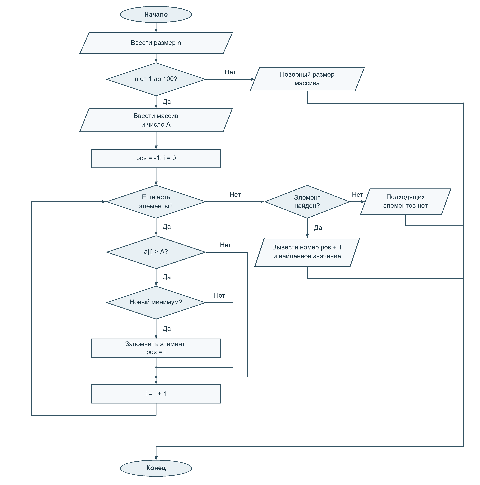

# Индивидуальное задание. Вариант 6
Найти порядковый номер минимального элемента массива среди элементов,
которые строго больше заданного числа `A`.
## Ввод
1. Число элементов `n` от 1 до 100.
2. `n` вещественных значений массива.
3. Число `A`, с которым сравниваются элементы.
Дробные числа вводятся через запятую, например `2,5`.
## Функция поиска
```c
int find_min_greater(double *a, int n, double A)
```
Функция получает адрес массива, число элементов и значение `A`.
Она возвращает порядковый номер подходящего элемента, начиная с 1,
или `-1`, если подходящих элементов нет.
## Алгоритм
1. Записать в `pos` значение `-1`: подходящий элемент пока не найден.
2. Перебрать элементы массива.
3. Рассматривать только элементы, для которых `a[i] > A`.
4. Если элемент первый подходящий или меньше найденного, сохранить его индекс в `pos`.
5. Если `pos` осталось равным `-1`, вернуть `-1`.
6. Иначе вернуть `pos + 1` - порядковый номер элемента.
Индексы в C начинаются с 0, а порядковые номера в результате - с 1.
При одинаковых минимальных значениях выбирается первое.
Элементы, равные `A`, не подходят. Отрицательные значения тоже могут подходить,
если они больше `A`.
## Пример
Ввод:
```text
6
-2 7 4 9 6 4
3
```
Из чисел, больших 3, минимально число 4.
Оно впервые встречается на третьем месте.
Результат:
```text
Номер элемента: 3
Значение: 4,00
```
Если в этом примере ввести `A = 10`, программа сообщит, что подходящих элементов нет.
## Блок-схема

На схеме раскрыт алгоритм функции поиска и показаны ввод и вывод в `main`.
Все проверки и действия представлены отдельными блоками.
